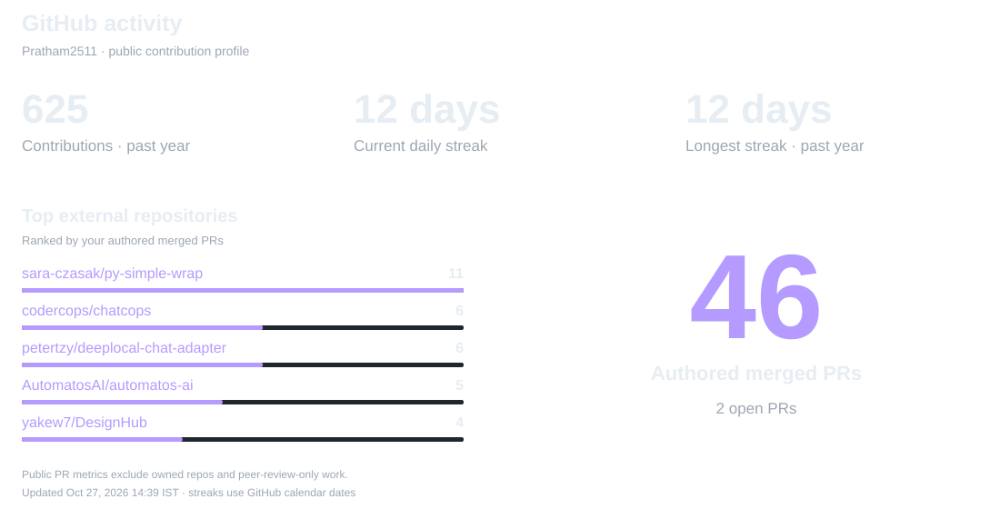

 

**Building security systems, developer intelligence, and research software with product-level execution.**

 

  

 

  <h2>◆ SELECTED SYSTEMS ◆</h2>
  
<i>Projects where product, systems engineering, data, and AI meet.</i>

<table>
<tr>
<td width="50%" valign="top">
<h3>01 · TGDetect V3</h3>
<b>Temporal graph security detection &amp; investigation.</b>
  
Combines a trained temporal graph model with searchable events, connected entity graphs, and alert evidence. Supports chronological path exploration and dataset uploads, with recorded CADETS evaluation kept separate from live analysis.
  
<code>Python</code> <code>PyTorch</code> <code>FastAPI</code> <code>Next.js</code> <code>React</code> <code>TypeScript</code>
  

</td>
<td width="50%" valign="top">
<h3>02 · Verbis</h3>
<b>AI database assistant that lives inside VS Code.</b>
  
Transforms natural-language questions into SQL/NoSQL, explores schemas, generates ER diagrams, tracks query history, and adds privacy controls such as schema anonymization and PII masking. Supports cloud and local LLM workflows.
  
<code>TypeScript</code> <code>React</code> <code>Python</code> <code>FastAPI</code> <code>VS Code API</code>
  

</td>
</tr>
<tr>
<td width="50%" valign="top">
<h3>03 · Kivo</h3>
<b>Local-first scholarly research workspace for evidence-driven literature review.</b>
  
Searches academic providers directly, preserves source passages with provenance, supports screening and evidence matrices, and exports reproducible research records. The baseline research workflow remains usable with AI disabled.
  
<code>Next.js</code> <code>TypeScript</code> <code>PostgreSQL</code> <code>Prisma</code> <code>Research APIs</code>
  

</td>
<td width="50%" valign="top">
<h3>04 · MCPVeil</h3>
<b>Local security regression testing for MCP servers.</b>
  
Runs bounded security probes against MCP servers and records findings, coverage, and incomplete scans. Produces JSON/SARIF reports and CI exit codes, with local analysis that needs no LLM or analysis-service API key.
  
<code>TypeScript</code> <code>Node.js</code> <code>MCP SDK</code> <code>Vitest</code> <code>SARIF</code>
  

</td>
</tr>
</table>

<a href="https://github.com/Pratham2511?tab=repositories"><b>Explore every repository →</b></a>

 

  <h2>◆ ENGINEERING STACK ◆</h2>
  
<i>The tools behind my security, research, and developer projects.</i>

<table>
<tr>
<td width="22%" valign="middle"><b>Languages</b></td>
<td>

</td>
</tr>
<tr>
<td width="22%" valign="middle"><b>Web &amp; APIs</b></td>
<td>

</td>
</tr>
<tr>
<td width="22%" valign="middle"><b>Data</b></td>
<td>

</td>
</tr>
<tr>
<td width="22%" valign="middle"><b>AI &amp; ML</b></td>
<td>

</td>
</tr>
<tr>
<td width="22%" valign="middle"><b>Delivery &amp; Design</b></td>
<td>

</td>
</tr>
</table>

 

<picture>
  <source media="(prefers-color-scheme: light) and (max-width: 600px)" srcset="./assets/profile-stats-mobile-light.svg" />
  <source media="(prefers-color-scheme: light)" srcset="./assets/profile-stats-light.svg" />
  <source media="(max-width: 600px)" srcset="./assets/profile-stats-mobile.svg" />
  
</picture>
